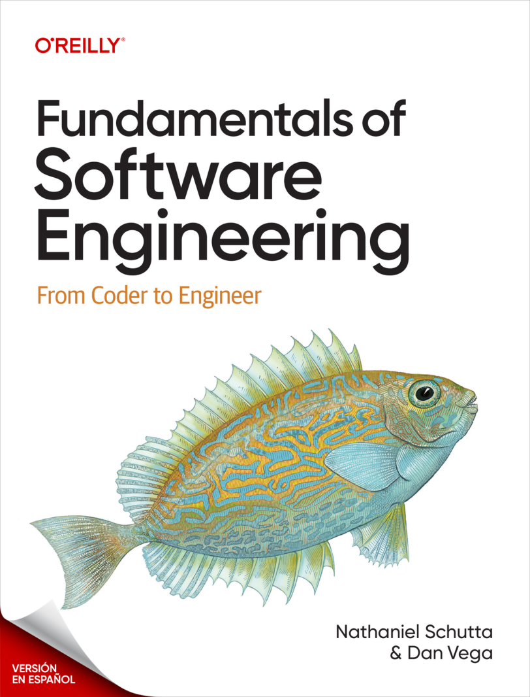
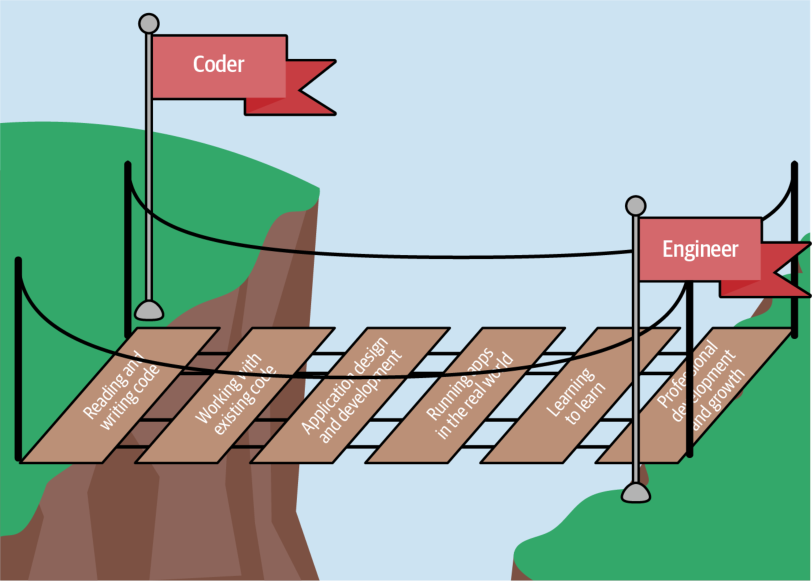
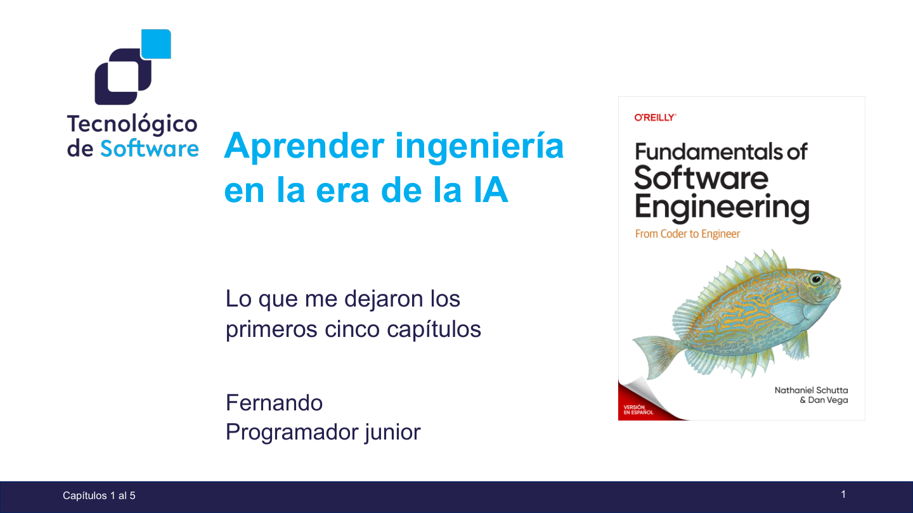
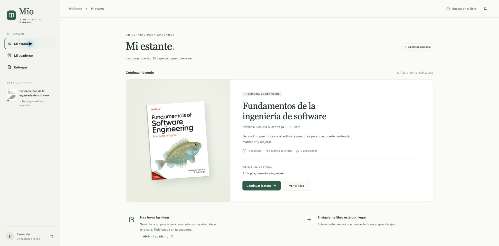

<div align="center">

# 📚 Mïo · La biblioteca de Fernando

**Lecturas, ideas y aprendizajes en mi camino hacia la ingeniería de software.**

Una biblioteca personal para leer con calma, volver a las ideas importantes y convertir lo aprendido en práctica.

<p>
  <kbd>🧠 Ingeniería de software</kbd> · <kbd>🤖 Aprendizaje con IA</kbd> · <kbd>🔖 Notas de lectura</kbd>
</p>



**Mi primera lectura: Fundamentos de la ingeniería de software**
Nathaniel Schutta y Dan Vega · O’Reilly

</div>

## 🧭 Empezar aquí

| Quiero… | Ir a… |
| --- | --- |
| Ver la presentación final | [Abrir el PDF](entregas/fundamentos-ingenieria-software/capitulos-01-05/presentacion.pdf) |
| Editar las diapositivas | [Descargar el PowerPoint](entregas/fundamentos-ingenieria-software/capitulos-01-05/presentacion.pptx) |
| Elegir un capítulo del libro | [Índice de PDFs](libros/fundamentos-ingenieria-software/README.md#pdfs-en-orden-de-lectura) |
| Leer sin conexión | Abrir `Abrir libro.html` después de descargar o clonar la biblioteca |
| Revisar todas las entregas | [Carpeta de entregas](entregas/README.md) |
| Repasar lo aprendido | [Buenas prácticas](#buenas-practicas) |

Los enlaces a PDF se pueden consultar desde GitHub. El lector HTML se abre localmente en el navegador; GitHub muestra su código, no lo ejecuta.

## 🌱 Por qué existe esta biblioteca

Soy Fernando, programador junior. Trabajo con inteligencia artificial a diario y utilizo agentes como Claude Code y Codex. Me entusiasma descubrir herramientas nuevas, pero también quiero desarrollar el criterio para comprender, explicar y mantener el software que construyo.

Esta biblioteca reúne los libros que voy leyendo y los materiales que preparo a partir de ellos. Mi propósito es aprender cómo se vive la ingeniería de software: leer código ajeno, tomar decisiones, trabajar con otras personas y cuidar sistemas a lo largo del tiempo.

## 📚 En mi estante

| Libro | Mi avance registrado | Material disponible |
| --- | --- | --- |
| [Fundamentos de la ingeniería de software](libros/fundamentos-ingenieria-software/README.md) | Capítulos 1–5 leídos | 22 PDFs de origen · lector interactivo · presentación de 20 diapositivas |

> 📌 **Biblioteca en crecimiento.** Iré añadiendo nuevos libros, notas y presentaciones. Las buenas prácticas también crecerán conforme avance en esta lectura y encuentre nuevas ideas que aplicar.

### Del código al trabajo de ingeniería

<p align="center">
  
</p>

La primera lectura conecta la programación con el mantenimiento de sistemas reales. Entre los aprendizajes que recojo están la legibilidad del código, la documentación que conserva el contexto, los modelos comprensibles y las pruebas que dan confianza para cambiar.

*Imagen: figura P-1 del prefacio del libro.*

<a id="buenas-practicas"></a>

## 🛠️ Buenas prácticas

<kbd>📖 Capítulos 1–5</kbd> · <kbd>🌱 En construcción</kbd>

Estos son los hábitos que quiero incorporar a mi trabajo como ingeniero de software. Son una síntesis personal de la lectura; los ejemplos describen cómo quiero llevarla a la práctica.

**Pulsa cada concepto para desplegarlo.**

<details>
<summary><strong>📝 Mantener la documentación al día</strong></summary>

Un buen ingeniero tiene presente que el software necesita contexto para poder mantenerse. La documentación forma parte del trabajo: si cambia el comportamiento, también hay que revisar lo que se explica sobre él.

**Cómo quiero aplicarlo:**

- Actualizar las instrucciones de instalación, configuración y uso cuando el cambio las afecte.
- Explicar por qué tomé una decisión y qué restricciones influyeron en ella.
- Revisar comentarios y ejemplos para que sigan siendo ciertos; evitar repetir lo que el código ya expresa con claridad.

**Mi pregunta antes de terminar:** ¿otra persona podría ejecutar el proyecto y entender esta decisión con lo que dejé escrito?

*Base: capítulos 2, 3 y 4 · lectura de código, comentarios y modelos.*

</details>

<details>
<summary><strong>🧪 Trabajar con pruebas que den confianza para cambiar</strong></summary>

Los tests permiten comprobar comportamientos y detectar regresiones. Hay que entender qué verifica cada prueba y elegir el tipo adecuado: unitarias para reglas aisladas, de integración para la colaboración entre componentes y de extremo a extremo para recorridos completos.

**Cómo quiero aplicarlo:**

- Leer y ejecutar las pruebas relevantes antes de modificar una funcionalidad.
- Comprobar resultados con aserciones útiles, incluyendo casos límite y errores importantes.
- Volver a ejecutarlas después del cambio e investigar los fallos antes de integrar.

**Mi pregunta antes de terminar:** ¿esta prueba fallaría si rompiera la regla que quiero proteger? La cobertura indica qué código se ejecutó; por sí sola no demuestra que el resultado sea correcto.

*Base: capítulos 2 y 5 · pruebas como documentación, confianza, tipos de pruebas y aserciones.*

</details>

<details>
<summary><strong>🗺️ Dejar un modelo que ayude a entender lo construido</strong></summary>

La base de código puede quedar en manos de otra persona, o de mi yo del futuro. Quiero dejar una explicación visual de los componentes, sus responsabilidades y sus relaciones. El modelo debe responder una pregunta concreta y ser sencillo para su audiencia.

**Cómo quiero aplicarlo:**

- Mostrar el contexto y los límites del sistema antes de entrar en detalles.
- Elegir una vista de componentes, secuencia o datos según lo que necesite explicar.
- Mantener nombres, leyendas y relaciones claros, y actualizar el modelo cuando cambie lo que representa.

**Mi pregunta antes de terminar:** ¿alguien que recibe este proyecto podría explicar cómo funciona usando este modelo? No hace falta dibujar cada clase ni reunir todo en un solo diagrama.

*Base: capítulo 4 · tipos de diagramas, sencillez y conocimiento del público.*

</details>

<details>
<summary><strong>📖 Leer el código y su contexto antes de juzgarlo</strong></summary>

Una parte importante del trabajo consiste en leer software existente. Antes de decidir que algo está mal, necesito entender qué problema resolvía, cómo se usa y qué restricciones había cuando se construyó.

**Cómo quiero aplicarlo:**

- Seguir un caso de uso pequeño desde su entrada hasta su resultado.
- Consultar pruebas, historial de cambios y documentación para reconstruir la intención.
- Utilizar el IDE y el depurador para contrastar mi interpretación con el comportamiento real.

**Mi pregunta antes de cambiarlo:** ¿entiendo por qué existe esta solución o solo sé que yo la habría escrito de otra manera?

*Base: capítulo 2 · sesgos, arqueología del software y estrategias de lectura.*

</details>

<details>
<summary><strong>✍️ Escribir código para la siguiente persona</strong></summary>

El código comunica decisiones a otros desarrolladores. La corrección y la estructura importan, y deben acompañarse de nombres y responsabilidades que permitan comprender lo que ocurre sin descifrar trucos.

**Cómo quiero aplicarlo:**

- Usar nombres del dominio que expliquen la intención de variables, funciones y clases.
- Mantener funciones enfocadas y convenciones consistentes con el proyecto.
- Preferir una expresión clara frente a una solución ingeniosa que cueste mantener.

**Mi pregunta antes de terminar:** ¿otra persona podría explicar el propósito de este código sin que yo esté a su lado?

*Base: capítulos 1 y 3 · regla de oro, legibilidad y código ingenioso.*

</details>

<details>
<summary><strong>🔎 Entender el problema antes de implementar</strong></summary>

Ir rápido hacia una solución puede ocultar que todavía no comprendí la necesidad. Pensar, preguntar y buscar la causa del problema también forman parte de programar.

**Cómo quiero aplicarlo:**

- Describir qué necesita la persona que utilizará el sistema.
- Identificar restricciones y acordar un resultado observable que permita evaluar la solución.
- Investigar la causa de un fallo antes de añadir una solución provisional.

**Mi pregunta antes de escribir código:** ¿puedo explicar el problema sin mencionar todavía una herramienta o tecnología?

*Base: capítulo 1 · fundamentos y evitar soluciones precipitadas.*

</details>

<details>
<summary><strong>🧩 Mantener la solución tan simple como permita el problema</strong></summary>

Más capas, patrones o líneas de código no implican una mejor solución. Quiero que cada responsabilidad y cada abstracción tengan una razón que pueda explicar.

**Cómo quiero aplicarlo:**

- Revisar si el proyecto ya dispone de una solución antes de construir otra.
- Evitar duplicar reglas de negocio que después tendrían que cambiar en varios lugares.
- Crear abstracciones cuando aclaren una necesidad real y revisar cuánto cuesta entenderlas.

**Mi pregunta antes de terminar:** ¿esta complejidad ayuda a resolver el problema o solo añade trabajo para quien lo mantenga?

*Base: capítulo 3 · no reinventar la rueda, menos es más y cuidado con la repetición.*

</details>

<details>
<summary><strong>🤝 Revisar código para aprender y mejorar</strong></summary>

Una revisión merece atención real. Sirve para contrastar decisiones, encontrar problemas y compartir conocimiento; aprobar un cambio sin comprenderlo pierde esa oportunidad.

**Cómo quiero aplicarlo:**

- Preparar cambios pequeños y explicar qué resuelven y cómo los comprobé.
- Preguntar por la intención y argumentar las observaciones con respeto.
- Recibir comentarios con apertura y distinguir un problema del código de una preferencia personal.

**Mi pregunta durante la revisión:** ¿estoy ayudando a mejorar el comportamiento y la comprensión del sistema?

*Base: capítulo 3 · revisiones, crítica y confianza entre personas.*

</details>

<details>
<summary><strong>🤖 Aplicar estos hábitos cuando trabajo con agentes de IA</strong></summary>

Esta es mi aplicación personal de los primeros cinco capítulos al uso de Claude Code y Codex. Delegar una implementación no elimina mi responsabilidad de entenderla, comprobarla y mantenerla.

**Cómo quiero aplicarlo:**

- Dar al agente un problema claro, contexto y criterios de aceptación.
- Leer el cambio propuesto, contrastar sus explicaciones y ejecutar las pruebas relevantes.
- Integrar solo lo que pueda explicar y dejar actualizados los modelos y la documentación afectados.

**Mi pregunta antes de aceptar el cambio:** ¿tengo evidencia de que funciona y entiendo qué consecuencias tiene?

*Aplicación personal de los capítulos 1–5; no es un resumen del capítulo 15 sobre IA.*

</details>

📚 **Referencia:** [Fundamentos de la ingeniería de software · índice y capítulos](libros/fundamentos-ingenieria-software/README.md#pdfs-en-orden-de-lectura). Ampliaré esta sección con los siguientes capítulos y los nuevos libros de la biblioteca.

## 🎤 Mi presentación de los capítulos 1 al 5

<p align="center">
  <a href="entregas/fundamentos-ingenieria-software/capitulos-01-05/presentacion.pdf"></a>
</p>

Una exposición desde mi perspectiva como junior: qué he aprendido del libro y cómo quiero aplicarlo al trabajar con agentes de IA. Incluye figuras del libro, ejemplos y notas para exponer en el PowerPoint.

**[Ver PDF](entregas/fundamentos-ingenieria-software/capitulos-01-05/presentacion.pdf)** · **[PowerPoint editable](entregas/fundamentos-ingenieria-software/capitulos-01-05/presentacion.pptx)**

## 🗂️ Cómo está organizada

```text
📚 biblioteca-personal/
├── README.md
├── Abrir libro.html    # Acceso directo a la biblioteca
├── biblioteca.html
├── app/                # React, TypeScript y componentes shadcn/ui
├── entregas/
│   └── fundamentos-ingenieria-software/
│       └── capitulos-01-05/
│           ├── presentacion.pdf
│           └── presentacion.pptx
├── libros/
│   └── fundamentos-ingenieria-software/
│       ├── README.md
│       ├── pdfs/          # Archivos numerados en orden de lectura
│       ├── lector/        # Lectura sin conexión e imágenes
│       └── herramientas/  # Fuentes para reconstruir el lector
└── docs/
    └── imagenes/          # Vistas previas del repositorio
```

`entregas/` conserva solamente la versión vigente de cada presentación. Los nombres se mantienen estables para poder abrir siempre la última entrega desde estos enlaces.

## 💻 Leer en mi computadora

1. Descargar el repositorio o clonarlo con mi cuenta de GitHub.
2. Abrir `biblioteca.html` (o `Abrir libro.html`) con el navegador.
3. Elegir el capítulo y ajustar el tema, tamaño de letra e interlineado.

El lector incluye búsqueda, índice, modo enfoque, imágenes ampliables, marcadores, notas y guardado de posición. La interfaz utiliza componentes **shadcn/ui**, con temas claro, sepia y oscuro. No requiere instalar Node, internet ni un servidor para leer.

### 🖍️ Subrayar y conservar ideas

1. Seleccionar un fragmento del texto.
2. Elegir uno de los **cinco colores**, el grosor y el trazo: **resaltador, bolígrafo, lápiz discontinuo u ondulado**.
3. Pulsar **Marcar texto** o **Añadir nota**.
4. Abrir **Mi cuaderno** para buscar las anotaciones, filtrarlas por capítulo o regresar al pasaje.

Pulsar un texto marcado permite cambiar su color, trazo y nota, o eliminarlo. Después de eliminar hay una opción **Deshacer**. Los trazos se aplican a texto seleccionado; no son dibujo a mano alzada.



[Ver los controles de anotación](docs/imagenes/anotaciones.jpg)

Las anotaciones, notas y marcadores se guardan en el navegador, **no en GitHub**. En **Ajustes de lectura → Exportar respaldo** se descarga un JSON con todos ellos. **Importar respaldo** combina los datos y conserva las notas existentes. Conviene exportar antes de mover la carpeta, cambiar de navegador o borrar sus datos.

Se conserva la ruta del lector y la clave de almacenamiento anterior para recuperar las notas existentes. Si utilizabas otra copia o ubicación del HTML, exporta desde ella e importa el respaldo en esta biblioteca.

Para modificar o reconstruir la interfaz, consultar la [guía técnica de la aplicación](app/README.md).

## 📬 Agregar la siguiente lectura

Crear una carpeta `libros/nombre-del-libro/` con su ficha e índice. Guardar ahí los PDFs y, si existe, su lector. Los materiales para exponer van en `entregas/nombre-del-libro/tema/`. Después, añadir el libro a la tabla del estante y enlazar sus entregas.

---

**Biblioteca privada para mi estudio personal.** Los libros, sus portadas y sus ilustraciones pertenecen a sus respectivos autores y editoriales. Las notas y presentaciones recogen mi proceso de aprendizaje; las fuentes de la presentación están en sus notas.
